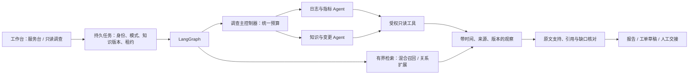

# IT 运维知识助手：Agent 深化交付

本次实现沿用 LangGraph、PostgreSQL 任务生命周期、知识版本、当前来源权限、工单草稿确认与人工交接。新增能力以实验开关接入；默认服务台行为继续兼容旧请求。公开合成演示可以运行单 Agent 或双调查 Agent，真实模型能力与企业资料质量仍待独立验收。

## 已实现的模块

| 模块 | 入口与约束 |
|---|---|
| Agentic RAG | `app.agent.agentic_rag`。最多两轮追加检索、最多四次局部决策；引用只能指向实际读取且当前有权访问的来源；不足时请求澄清。 |
| 六个只读工具 | `search_knowledge`、`get_service_health`、`query_error_logs`、`query_metrics`、`get_release_changes`、`lookup_ticket`。授权上下文来自应用，参数严格校验，调用审计包括拒绝记录。 |
| 来源关系层 | PostgreSQL 候选图、来源校验、管理员发布、每个知识版本的单一激活指针、回滚。最多两跳、100 条候选、重复边去重；未发布候选和无权限桥接不参与召回。 |
| 调查协作 | 日志指标与知识变更子 Agent 各自拥有工具循环、独立上下文和允许工具。共享父预算与取消。普通问答采用单 Agent；调查可选择 single / multi。 |
| 报告与恢复 | 实际观察、支持原文、假设、冲突、缺口、下一步分别保存。持久进度记录阶段和已提交产物；采用任务级恢复，未实现节点级 checkpointer。 |
| MCP | 官方 SDK 2.3.0，stdio 公开快照演示与现有身份、CSRF 保护的 Streamable HTTP。独立协议客户端可验证工具发现和调用。 |
| Kubernetes 读取 | 可信固定 kubeconfig、kind context、服务到 namespace/deployment/selector 映射；只执行 get/logs。当前 ready 比例不代表请求可达性，不提供历史可用率或未配置延迟指标。 |
| 工作台 | 显式任务模式、调用摘要、可展开观察、快照/实时标记、知识版本和刷新恢复；现有工单与交接保留。 |

## 契约

原任务提交请求新增可选 `task_mode: support | investigate`。省略保持服务台行为；模式进入请求身份，同一幂等键不能改变模式。模型 `AgentDecision` 仅表达工具调用、澄清或结束，不能提供身份、角色或授权范围。

`TaskBudget` 统一限制模型次数、工具次数、预留 Token 与总时间。输入按 UTF-8 大小作保守上界，输出按配置上限、重试次数预留；实际消费另计，重试消费不确定时明确记录。默认 12 次模型、12 次工具、48,000 预留 Token、90 秒；冻结对照和合成协作演示使用相同的 256,000 预留上限。预算不足输出部分完成，不宣称完整结论。

每条工具观察包含观察身份、工具、状态、时间、来源类型和受控数据；知识观察携带知识版本，历史快照携带快照标识。超时、缺失或撤权产生未知/失败。任务提交、进度与最终写入使用租约令牌，撤权后历史页面重新过滤引用和报告，迟到子任务不能提交越权产物。

图关系必须引用原 chunk 的确切证据。明确文档行可生成候选，发布仍需要可信管理员。关系不能代替原文，图的激活状态与知识版本绑定。管理接口为 `/api/v1/agent/graphs`、`/graphs/candidates`、`/graphs/{id}`、`/publish`、`/activate`。

关键代码：`backend/app/agent/`、`backend/app/production/relations.py`、`agent_models.py`、`agent_api.py`、`runs.py`、`worker.py`、`backend/app/runtime.py`、`frontend/src/production/InvestigationPanel.tsx`。迁移为 `0007_agent_deepening.py`；应用前按既有备份与发布流程执行，演练仅使用隔离测试库。

## 证据与下一步

[运行说明](runbook.md)、[评测与采用报告](evaluation.md)、[故障覆盖](fault-coverage.md)、[版本清单](versions.json) 和 `evidence/` 保存本次证据。旧版 [待办](../improvement-backlog.md) 中 PDF/目标环境验收边界继续适用。

关系层是轻量关系增强检索，没有实现 Microsoft GraphRAG 社区摘要或全局搜索。真实 embedding、真实企业身份与资料、模型任务成功率、独立人工相关集合和引用支持率不由合成演示替代。

最终一次复核的发现、TDD 修复及未独立判断范围见 [final-review.md](final-review.md)；所有实现裁决和代价在 [execution-ledger.md](execution-ledger.md) 留档。

消息历史、事件和进度读取使用当前服务授权，缺失范围默认为空。模型调用超时或取消时保留未知用量标记，月预算按预留消费结算，不能把未知调用当作零成本。
